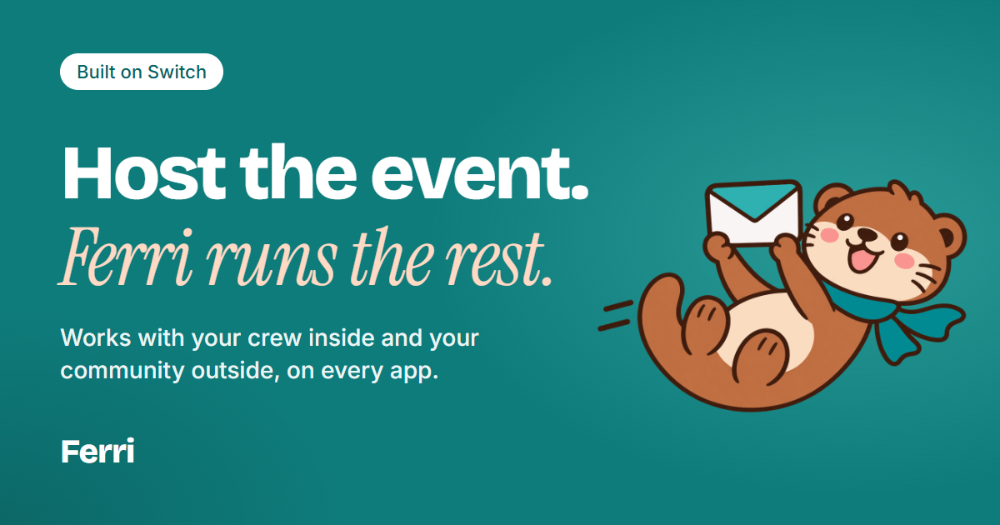
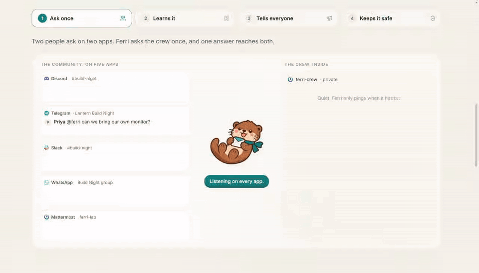
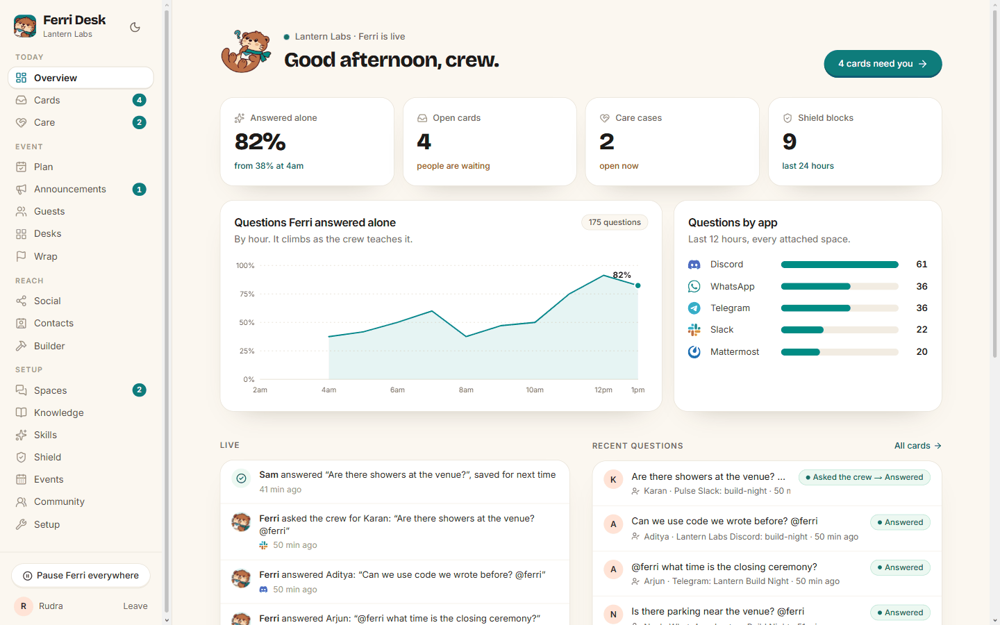
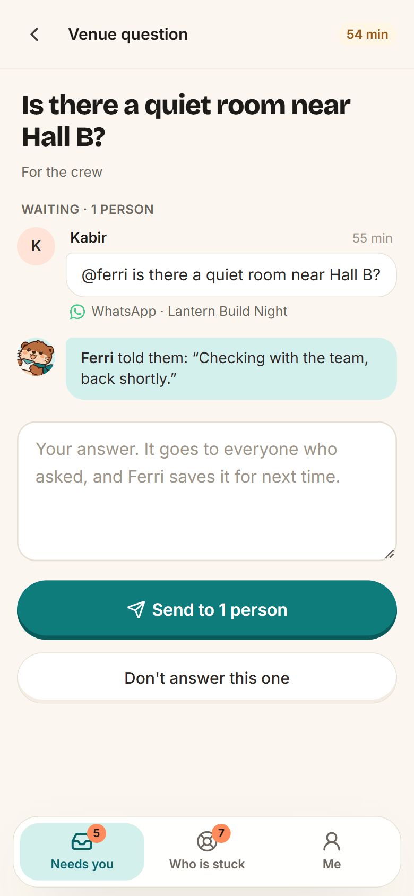
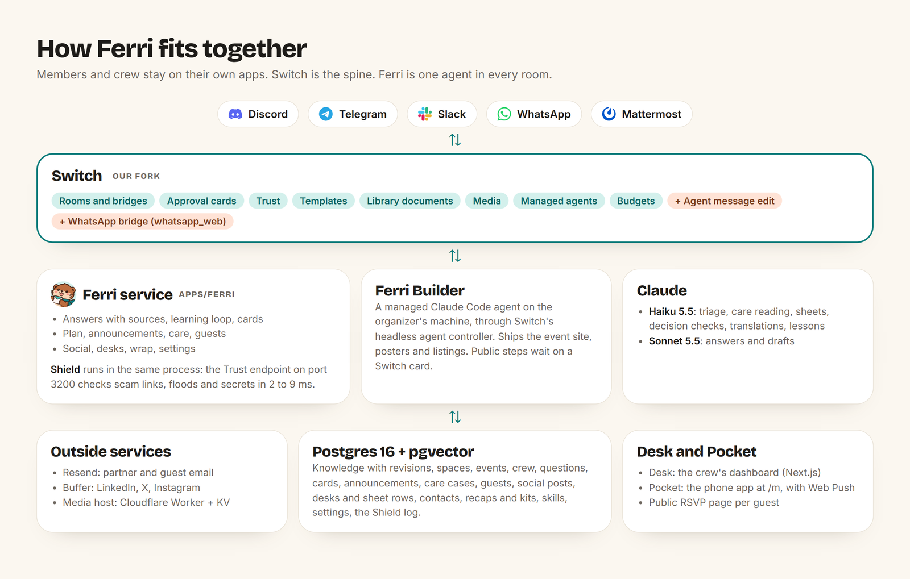

# Ferri

<p align="center"></p>

**The AI teammate for people who host community events.** Every event has two sides: the crew that plans and decides, and the community that asks, in groups on Discord, Telegram, Slack, Mattermost and WhatsApp. Ferri is the bridge between them: it answers the community from what the crew knows, asks the crew only when it does not know, and turns each crew decision into an update in every group after one OK.

[](https://github.com/RudraO2/Ferri/actions/workflows/ci.yml) [](https://github.com/RudraO2/Ferri/actions/workflows/quickstart.yml)

**Live demo:** ask Ferri yourself, in Discord (https://discord.gg/5FWRzfCcNa, channel `#build-night`) or Telegram (https://t.me/+-7EpwBLi8QxlNDJl). Try `@ferri when does hacking start?` or anything about Lantern Build Night (a made-up event). Ferri answers with its source. When it does not know, it asks the crew in a private room and comes back to you with their answer. Shield checks every message. Look around its Desk at https://ferri-demo.rudratechie.xyz with "Look around (read-only)". The demo runs this repo's stack on a small server ([docs/hosting.md](docs/hosting.md)).

Video: (link coming)

## How Ferri uses Switch

### Which agents are connected

- **Ferri**, our always-on custom agent. It speaks Switch's agent protocol through our TypeScript client in `packages/switch` (SSE down, HTTP up), and one connection serves every room on every platform. Claude Sonnet 5.5 writes its answers, plans and drafts; Claude Haiku 5.5 reads every message.
- **Ferri Builder**, Claude Code run by Switch itself as a managed agent, on a Switch agent controller on the organizer's machine. Ferri creates it through Switch's agent management and hands it jobs in the crew room: the event site, posters, listings. Its permission prompts are Switch cards, and a Switch budget caps it. It runs Claude Opus 5.5 at high effort by default; our tests run it on Haiku 5.5 at low effort. The Builder runs on a real machine, so it is not part of the public demo server.

### How the channels are set up

- Every group on Discord, Telegram, Slack, Mattermost and WhatsApp is a Switch room. `./ferri connect` adds the Telegram, Discord or Slack bridge through Switch's Gateway. Mattermost comes connected in the local stack. WhatsApp goes through `whatsapp_web`, the bridge we added in our Switch fork.
- Ferri joins a room with `!invite-agent @ferri` (or Add Ferri in Desk). Each room is then a space, attached to an event with a mode: Off, Listen, Approve or Auto. One room per event is the crew room, where cards land.
- Question, approval and permission cards are Switch cards, answered in the room, in Desk or in Pocket.
- Switch Trust sends every message to Shield, our Trust endpoint inside Ferri, once `./ferri shield:connect` turns it on.
- Switch templates make desk and team rooms as real channels. Plans, recaps and sheets are Switch library documents. Announcements are edited in place through the agent message edit we added to our fork.

Every Switch feature Ferri uses, and the code that uses it: [docs/architecture.md](docs/architecture.md).

### How to run it

1. [Quick start](#quick-start): `./ferri up` needs only Docker and an Anthropic key, and starts with Mattermost and a demo event.
2. Connect your platforms: [docs/platforms.md](docs/platforms.md), and [docs/whatsapp.md](docs/whatsapp.md) for WhatsApp.
3. Add the Builder on a machine with Node 22 and Claude Code: [docs/builder.md](docs/builder.md).
4. Make it yours, with your community, your event and your FAQ in place of the demo: [docs/your-community.md](docs/your-community.md). The keys and accounts for each part are in [docs/accounts.md](docs/accounts.md).

## Quick start

```bash
git clone https://github.com/RudraO2/Ferri.git
cd Ferri
./ferri up
```

On Windows, the last command is `.\ferri up` in PowerShell, or `ferri up` in cmd. It asks for your Anthropic API key once, then starts Switch, Mattermost, Ferri and Desk in Docker with a demo event. When it prints the logins, open Mattermost at http://localhost:8065, go to `ferri-lab` and say `@ferri when does hacking start?`.

### Requirements

- Docker Desktop (Windows, macOS) or Docker Engine with the compose plugin v2.22 or newer (Linux).
- About 4 GB of free RAM (8 GB is comfortable) and about 8 GB of disk.
- An Anthropic API key: platform.claude.com, Settings, API keys, Create key, with one workspace picked for it ([docs/accounts.md](docs/accounts.md) says why).
- Nothing else: no Node, no Switch checkout.

### What `./ferri up` does

1. Asks for the Anthropic key once and generates every other secret into `.env`.
2. Pulls the images. If it cannot pull one of Ferri's two images, it builds it: Ferri's from the checkout, Switch's core from our Switch fork at a pinned commit. The first run downloads about 3 GB and takes several minutes.
3. Starts Switch (core, dashboard, Postgres), Mattermost, Ferri's Postgres, Ferri and Desk, and waits until they are healthy.
4. Registers Ferri in Switch (a personal agent key, open addressing), creates the rooms `ferri-lab` and `ferri-crew`, the test people `meera`, `arjun` (members) and `priya` (crew), and loads the demo community Lantern Labs and its event, Lantern Build Night.
5. Prints the addresses, the logins and three messages to try.

Running it again changes nothing that is already set.

## What you get

| What | Address | Sign in |
|---|---|---|
| Mattermost, the chat to try Ferri in | http://localhost:8065 | `user` and the password `./ferri up` prints. The test people `meera`, `arjun` and `priya` share a second printed password. |
| Desk, the organizers' dashboard | http://localhost:3100 | `admin@switch.local` and the password `./ferri up` prints |
| Ferri Pocket, the crew's phone app | http://localhost:3100/m | Same as Desk |
| Switch dashboard | http://localhost:3300 | Same as Desk |
| Switch API | http://localhost:8800 | Used by Ferri and the scripts |
| Ferri's Postgres | localhost:5433 | `ferri` / `ferri`, for running Ferri on the host |

- The passwords are also in `.env`: `MATTERMOST_USER_PASSWORD`, `MM_TEST_PASSWORD` and `GATEWAY_ADMIN_PASSWORD`.
- Every port is bound to 127.0.0.1 only. To change one, set `DESK_HOST_PORT`, `MATTERMOST_HOST_PORT`, `API_HOST_PORT`, `GATEWAY_HOST_PORT` or `FERRI_DB_HOST_PORT` in `.env`, then run `./ferri up`.

## Try it

In Mattermost:

1. In `ferri-lab`, say `@ferri when does hacking start?`. Ferri answers with the time and a Source line.
2. In `ferri-lab`, say `@ferri can I bring my dog?`. The demo knowledge does not cover it, so Ferri says it is checking with the crew, and a question card opens in `ferri-crew`.
3. In `ferri-crew`, answer the card with a button, or type `A1 "Yes, dogs are welcome"`. Ferri answers the asker in `ferri-lab` and remembers it, so the next person gets the answer at once.

Also try `does anyone know the wifi password?` in `ferri-lab`, with no mention. Ferri waits a short moment so a person can answer first, then answers with its source.

## Commands

On Windows, use `.\ferri` (PowerShell) or `ferri` (cmd) instead of `./ferri`.

| Command | What it does |
|---|---|
| `./ferri up` | Start everything. The first run asks for the key and writes `.env`. Safe to run again. |
| `./ferri down` | Stop. Keeps your data. |
| `./ferri reset` | Stop and delete all data (Switch, Mattermost, Ferri). Asks you to type `yes`. Keeps `.env`. |
| `./ferri logs [service]` | Follow the logs: `ferri`, `desk`, `switch`, `mattermost`, `ferri-setup`, ... |
| `./ferri ps` | What is running |
| `./ferri build` | Build Ferri's image from this checkout instead of pulling it |
| `./ferri pull` | Pull the newest images |
| `./ferri doctor` | Check the core of the stack and every optional part: on, off or broken, with the next step |
| `./ferri connect telegram --token <bot token>` | Connect Telegram ([docs/platforms.md](docs/platforms.md)) |
| `./ferri connect discord --token <bot token> --guild <server id>` | Connect Discord |
| `./ferri connect slack --bot-token xoxb-... --app-token xapp-...` | Connect Slack |
| `./ferri connect list` | List the platform connections in Switch |
| `./ferri space list`, `./ferri space attach <space> --mode auto` (or `--crew`) | See the rooms Ferri is in and attach one to the event, like Desk's Spaces page |
| `./ferri smoke` | Ask Ferri through Mattermost and check that it answers with a source (CI runs this) |
| `./ferri <script> [args]` | Run any `package.json` script inside the stack: `kb seed`, `kb list`, `kb ask "<question>"`, `shield:connect`, `email:setup`, `whatsapp:pair`, `crew:account`, `card:preview`, `push:keys`, `eval:answers`, ... |

After you edit `.env`, restart Ferri and Desk so they read it: `docker compose restart ferri desk`.

## Optional parts

Each one is off until you turn it on. `./ferri doctor` shows which are on, and the next step for each. Most need an account or a key of their own: [docs/accounts.md](docs/accounts.md) lists every one, where to get it, whether it is free, and its `.env` name.

| Part | What it does | Turn it on | Guide |
|---|---|---|---|
| Telegram | Ferri in Telegram groups | `./ferri connect telegram --token <bot token>` | [platforms.md](docs/platforms.md) |
| Slack | Ferri in Slack channels | `./ferri connect slack --bot-token xoxb-... --app-token xapp-...` | [platforms.md](docs/platforms.md) |
| Discord | Ferri in Discord channels | `./ferri connect discord --token <bot token> --guild <server id>` | [platforms.md](docs/platforms.md) |
| WhatsApp | Ferri in WhatsApp groups through a linked phone | Add `,whatsapp` to `COMPOSE_PROFILES` in `.env`, `./ferri up`, then `./ferri whatsapp:pair` | [whatsapp.md](docs/whatsapp.md) |
| Shield | Blocks scam links and link floods, redacts leaked keys, on every message | `./ferri shield:connect` | [shield.md](docs/shield.md) |
| Pocket push | The crew's phones buzz when a card needs them | Keys are generated. Phones need HTTPS: set `FERRI_PUBLIC_URL` and run a tunnel | [pocket.md](docs/pocket.md) |
| Email | Partner outreach and guest emails through Resend | Set `RESEND_API_KEY` and `FERRI_EMAIL_FROM`, then `./ferri email:setup` | [email.md](docs/email.md) |
| Social | Posts on LinkedIn, X and Instagram through Buffer | Set `BUFFER_API_KEY`, and `FERRI_MEDIA_URL` and `FERRI_MEDIA_SECRET` for images | [social.md](docs/social.md) |
| Builder | Claude Code, run by Switch on a real machine of yours (not in Docker, not on the public demo): the event site, posters, listings | On the host, with Node 22, Claude Code and `FERRI_PUBLIC_URL` set: `pnpm install`, `pnpm builder:setup`, then `pnpm builder:controller` | [builder.md](docs/builder.md) |
| Event site | The Builder ships the event's site on Supabase and Vercel | Sign in to the Supabase and Vercel CLIs on the Builder's machine, set `FERRI_SITE_SUPABASE_ORG` and `FERRI_PUBLIC_URL`, then `pnpm builder:setup` | [builder.md](docs/builder.md) |
| Posters | Background art for the Builder's posters | Set `OPENAI_API_KEY`, then `pnpm builder:setup` | [builder.md](docs/builder.md) |
| Luma API | Lists events through Luma's API instead of the Builder's browser | Set `LUMA_API_KEY` (Luma Plus only) | [builder.md](docs/builder.md) |

To run without Mattermost (for example on a small server that uses Telegram or Discord), remove `mattermost` from `COMPOSE_PROFILES` in `.env`.

## Troubleshooting

The most common ones:

- **"Docker is installed but not running"**: start Docker Desktop (or the Docker service), then `./ferri up` again.
- **A port is already in use**: change the matching `*_HOST_PORT` in `.env`, then `./ferri up`.
- **Switch answers "I'm currently offline"**: Ferri is not connected. `./ferri logs ferri` shows why, and `./ferri doctor` checks it.
- **Ferri does not answer at all**: usually `ANTHROPIC_API_KEY` is wrong or out of credit. `./ferri doctor` checks the key. Fix it in `.env`, then `docker compose restart ferri desk`.

Everything else, from ".env is a folder" to starting over, is in [docs/troubleshooting.md](docs/troubleshooting.md).

## What Ferri does

Built on [Switch](https://github.com/sandbox-quantum/switch) for the WeMakeDevs "Flip the Switch" hackathon (Track 1, best business workflow). Built by voice with Wispr Flow.

<p align="center"></p>

<table>
<tr>
<td width="68%"></td>
<td width="32%"></td>
</tr>
<tr><td align="center">Desk, the crew's control room</td><td align="center">Pocket, the crew's phone app</td></tr>
</table>

It covers the whole life of an event, from the crew's first chat to the starter kit for the next one: answers with sources on Mattermost, Slack, Discord, Telegram and WhatsApp; a living plan; announcements edited in place everywhere; care cases for members who are stuck or upset; the guest list and RSVPs; posts on LinkedIn, X and Instagram through Buffer; desks for judging, check-in and help, with live sheets; a recap and a starter kit at the end; and a coding agent, Ferri Builder, that Switch runs to ship the event site, posters and listings. Every step that reaches people outside waits for one OK on a Switch card.

### The problem

A hackathon, a meetup or a festival night has members on Discord, Telegram, Slack and a Mattermost or WhatsApp group, and a small crew of volunteers running it. The same three questions arrive forty times on five apps. Answers given in one group never reach the others. The crew decides something in their own chat ("lunch moves to 1:30") and half the members never hear it, or hear the old time. A fake "free nitro" link lands in the busiest channel at the worst moment. Every organizer we know runs this by hand, at night, on their phone.

### Three pillars

Ferri is one agent that works in two directions, with a bridge between them.

**1. Outward: answers on every platform, with sources.** Ferri sits in every group of the event, on Mattermost, Slack, Discord, Telegram and WhatsApp. It answers only from the event's knowledge and names the source under every answer, in the tone and language the crew set for that space. It also notices questions nobody addressed to it ("does anyone know the wifi password?"), waits a moment so a person can answer first, and steps in only when it has a sourced answer. Each space has a mode: Off, Listen, Approve (every reply waits for an organizer) or Auto. Ferri also notices people, not only questions: a member who is confused, stuck, upset or unsafe becomes a care case for the right person on the crew, and a technical problem can go to the Builder, which helps the member in their own room.

**2. Inward: the crew plans and decides, Ferri learns.** Before the event, Ferri follows the crew's own chat and keeps a living plan: what is decided, who owns what, tasks with deadlines, what is still open. "@ferri draft the agenda" gives a run of show plus one approval card per key decision. Owners named in the plan ("Priya will handle food") take over the routing, so food questions go to Priya. During the event, when Ferri does not know, the member hears "I'm checking with the team" at once, and a Switch question card opens in the crew room for the person who owns that topic (food, venue, judging). The owner's phone buzzes through Ferri Pocket. One answer, on the card, from Desk, or from the phone, reaches everyone who was waiting, on their own app, with a real mention. The answer is saved, so the next person gets it instantly. Nobody answers: Ferri nudges the owner, then the whole crew, and never invents an answer. "@ferri make a judging desk with arjun" makes a private channel for that job, with its own instructions and a live sheet Ferri keeps from what people say there ("Team Alpha 8 for innovation"). After the event, Ferri counts what happened in a recap, saves the partners, and builds a starter kit that the next event starts from.

**3. The bridge: a decision inside becomes an update outside.** "@ferri tell everyone lunch moves to 1:30" drafts an announcement and opens one approval card with the draft and every space it will reach. One OK posts it to every space of the event on every platform and saves it as knowledge. "@ferri change the lunch announcement, it's 1:45 now" and one more OK **edits the post in place** on Mattermost, Slack, Discord and Telegram. Ferri also follows the crew's own chat: when the crew settles something members need to know ("ok let's push judging to 4pm"), it offers the announcement on a card, credited to whoever decided, and never posts without the OK. Announcements can be scheduled; one not approved by its time is not sent, and the crew is told. A space with its own language gets its own translation, shown on the same card. The same one-card rule covers the guest list (reminders and spot offers by email) and social posts on LinkedIn, X and Instagram through Buffer.

### Around the pillars

- **Shield** keeps scam links, link floods and leaked API keys out of every room, on every platform, before anyone sees them. It is our own Switch Trust endpoint and answers in 2 to 9 ms, with no model in the path. [docs/shield.md](docs/shield.md)
- **Desk** is the organizers' dashboard: spaces and modes, master pause, cards, the plan, events and crew, knowledge with versions, announcements, care cases, guests, social posts, desks and sheets, contacts, wrap, skills and settings, the Builder, Shield, and a Setup page. [docs/dashboard.md](docs/dashboard.md)
- **Ferri Pocket** is the crew's phone app (a PWA with Web Push): the cards that need you (answers, announcements, care cases, guest sends, social posts, desks, wrap), Post, Edit, Don't post, who is stuck, and a `+ Announce` button. [docs/pocket.md](docs/pocket.md)
- **Customization**: the crew edits Ferri's skills in Desk and sets tone, language and timing per community, event or space, from Desk or by chat ("@ferri reply in Hindi in team-alpha"). The source check, the cards and the pause are in code, so no edit can turn them off. [docs/customization.md](docs/customization.md)
- **Ferri Builder** is Ferri's second pair of hands: a Claude Code agent that Switch itself runs on the organizer's machine, with its own folder, its own Claude home and its own token budget. "@ferri get the builder to make a one-page site for Build Night" hands it the job in the crew room; it reads the event's facts from the room's Switch documents, posts the page there, and asks on a card before anything goes public. [docs/builder.md](docs/builder.md)
- **Crew helpers**: "@ferri remind me at 5 to order the pizza", and "@ferri make team rooms for Team Alpha with meera and arjun", which makes real private channels on the platform from a Switch template. [docs/plan-and-launch.md](docs/plan-and-launch.md)

### Every feature, in detail

| Area | Guide |
|---|---|
| Make it yours: your community and your event in place of the Lantern demo | [docs/your-community.md](docs/your-community.md) |
| Bring your own accounts: every key Ferri can use, where to get it, free or paid | [docs/accounts.md](docs/accounts.md) |
| How Ferri answers and learns, the demo knowledge, `kb` commands | [docs/knowledge.md](docs/knowledge.md) |
| The plan before the event, and announcements inside to outside | [docs/plan-and-launch.md](docs/plan-and-launch.md) |
| Desk, the organizers' dashboard | [docs/dashboard.md](docs/dashboard.md) |
| Ferri Pocket, push and a public address | [docs/pocket.md](docs/pocket.md) |
| Telegram, Slack and Discord | [docs/platforms.md](docs/platforms.md) |
| WhatsApp | [docs/whatsapp.md](docs/whatsapp.md) |
| Ferri Builder: the event site, posters, listings on Luma | [docs/builder.md](docs/builder.md) |
| Partner outreach by email | [docs/email.md](docs/email.md) |
| Care for members who are stuck or upset | [docs/care.md](docs/care.md) |
| RSVP and the guest list | [docs/rsvp.md](docs/rsvp.md) |
| Social posts through Buffer | [docs/social.md](docs/social.md) |
| Desks, rooms for each job, with sheets | [docs/desks.md](docs/desks.md) |
| Wrap: recap, partners, starter kit, closing | [docs/wrap.md](docs/wrap.md) |
| Customization: skills, tone, languages, settings | [docs/customization.md](docs/customization.md) |
| Shield: safety on every message | [docs/shield.md](docs/shield.md) |

## How it is built

<p align="center"></p>

Ferri does not work without Switch. Every group on every platform is a Switch room, Ferri is one Switch agent in all of them, every approval is a Switch card, and every message passes Switch Trust. The full table of the Switch features Ferri uses, the diagram, the Docker stack and the repository layout are in [docs/architecture.md](docs/architecture.md).

We added two things to Switch core, in our fork ([`RudraO2/switch`, branch `ferri/agent-message-edit`](https://github.com/RudraO2/switch/tree/ferri/agent-message-edit)):

- **Agent message edit**: `POST /agents/{agent_id}/messages/{event_id}/edit`, so an announcement can be fixed in place on every platform. [Details](docs/architecture.md#what-we-added-to-switch-agent-message-edit)
- **A WhatsApp bridge, `whatsapp_web`**: WhatsApp groups through a linked device, as rooms like any other. [Details](docs/architecture.md#what-we-added-to-switch-a-whatsapp-bridge)

Both ship in Ferri's Switch core image, `ghcr.io/rudrao2/ferri-switch-core`, which `./ferri up` runs.

To change Ferri's code, run it on the host while the rest stays in Docker: [docs/development.md](docs/development.md). To host it on a server for your community: [docs/hosting.md](docs/hosting.md).

## How we checked it

- 255 unit tests, a typecheck of nine packages and Desk's production build pass.
- `pnpm eval:answers`: 158 of 158 fixed cases pass against the real model (Claude Haiku 5.5 at low effort).
- CI boots the whole stack with `./ferri up` on a clean runner and asks Ferri through Mattermost.
- Every feature was run end to end on the real local stack, with Mattermost, Slack, Discord, Telegram and WhatsApp connected, before the next one started.

What we ran, and what is not done yet: [docs/testing.md](docs/testing.md).

## License

MIT. Switch itself is licensed by SandboxAQ under its own terms (Apache 2.0 with the Commons Clause); Ferri talks to it over its public HTTP APIs.
