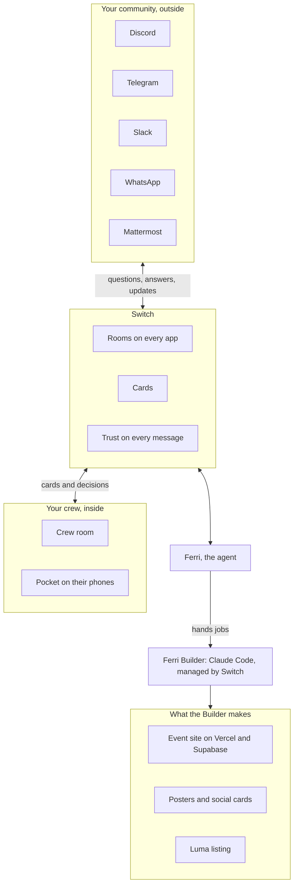

# Ferri

<p align="center"></p>

**Ferri is an AI teammate for people who host community events**, like hackathons, meetups and festival nights. Members ask the same questions in groups on several apps, and what the crew decides in its own chat often never reaches them. Ferri sits in every group of the event and in the crew's own room. It answers members with sources, brings the crew only what needs a person, and turns each crew decision into an update in every group after one OK. A second agent, Ferri Builder, makes the event's site, posters and Luma listing. Both run on [Switch](https://github.com/sandbox-quantum/switch).

## Two sides of every event

| With your crew, inside | With your community, outside |
|---|---|
| **Plan.** Ferri reads the crew's own chat and keeps the plan: decisions, owners, tasks with deadlines, open questions. | **Answers.** On Discord, Telegram, Slack, WhatsApp and Mattermost, only from the event's knowledge, with the source under every answer. |
| **Cards on Pocket.** A question only the crew can answer, a reply waiting for an OK or a member who needs care reaches the right person's phone. | **Care.** A member who is stuck, upset or unsafe becomes a case for the right person on the crew. |
| **Site and posters.** Ferri Builder makes the event site on Vercel and Supabase, and the posters and social cards, when the crew asks in its room. | **Shared everywhere.** After one OK, the site link and the poster go to every group, the poster as a real image. |
| **Luma and registrations.** The Builder lists the event on Luma after a card. Ferri keeps one guest list from the site, Luma and CSV files. | **Reminders.** Guests get reminders by email, and a freed spot goes to the next person on the waitlist, each after one OK. |
| **Announcements.** "@ferri tell everyone lunch moves to 1:30" drafts it, and one card shows the text and every group it will reach. | **Updates in place.** A later version edits the post in every group, so nobody sees the old time. |
| **Shield alerts.** The crew room hears what was stopped, and the leads get a push. | **Shield.** Scam links and link floods are blocked, and leaked keys are redacted, on every message before anyone sees them. |

**The bridge:** a crew decision becomes an update on every app after one OK. A question Ferri cannot answer becomes a card for the right crew member, and their answer reaches everyone who asked, on their own app.

How the pieces connect:



## Proof you can check

[](https://github.com/RudraO2/Ferri/actions/workflows/ci.yml) [](https://github.com/RudraO2/Ferri/actions/workflows/quickstart.yml)

- **Ask Ferri yourself** in the live demo, on Discord (https://discord.gg/5FWRzfCcNa, channel `#build-night`) or Telegram (https://t.me/+-7EpwBLi8QxlNDJl). Try `@ferri when does hacking start?` or anything about Lantern Build Night, a made-up event. Ferri answers with its source. When it does not know, it asks the crew in a private room and comes back to you with their answer.
- **Look around Desk**, read-only: open https://ferri-demo.rudratechie.xyz and pick "Look around (read-only)". The landing page is https://ferri-demo.rudratechie.xyz/welcome. The demo runs this repo's stack on a small server ([docs/hosting.md](docs/hosting.md)).
- **A site the Builder shipped**: https://lantern-build-night.vercel.app, made and deployed by Ferri Builder for the demo event, with registration, sign-in, schedule and FAQ, in the look of the posters it drew first.
- **CI on every push**: a typecheck of nine packages, 298 unit tests, Desk's production build, and a smoke test that builds Ferri's image from the commit, starts the stack and asks Ferri through Mattermost.
- **Quick start on every push**: a fresh GitHub runner, signed out of GHCR, runs `./ferri up` from scratch, then checks that Ferri answers with a source and opens a card for a question it cannot answer.
- **Evals**: `pnpm eval:answers` passes 158 of 158 fixed cases against the real model (Claude Haiku 5.5 at low effort).
- **End to end**: every feature ran on the real local stack, with Mattermost, Slack, Discord, Telegram and WhatsApp connected, before the next one started. What we ran, and what is not done yet: [docs/testing.md](docs/testing.md).

Video: (link coming)

## How Ferri uses Switch

### Which agents are connected

- **Ferri**, our always-on custom agent. It speaks Switch's agent protocol through our TypeScript client in `packages/switch` (SSE down, HTTP up), and one connection serves every room on every platform. Claude Sonnet 5.5 writes its answers, plans and drafts; Claude Haiku 5.5 reads every message.
- **Ferri Builder**, Claude Code run by Switch itself as a managed agent, on a Switch agent controller on the organizer's machine. Ferri creates it through Switch's agent management and hands it jobs in the crew room: the event site, posters, listings. Its permission prompts are Switch cards, and a Switch budget caps it. It runs Claude Sonnet 5.5 at medium effort by default; our tests run it on Haiku 5.5 at low effort. The Builder runs on a real machine, so it is not part of the public demo server. What it made for the demo event, from two crew messages: [the event's site](https://lantern-build-night.vercel.app) (registration, sign-in, schedule, FAQ), in the look of the posters it drew first.

### How the channels are set up

- Every group on Discord, Telegram, Slack, Mattermost and WhatsApp is a Switch room. `./ferri connect` adds the Telegram, Discord or Slack bridge through Switch's Gateway. Mattermost comes connected in the local stack. WhatsApp goes through `whatsapp_web`, the bridge we added in our Switch fork.
- Ferri joins a room with `!invite-agent @ferri` (or Add Ferri in Desk). Each room is then a space, attached to an event with a mode: Off, Listen, Approve or Auto. One room per event is the crew room, where cards land.
- Question, approval and permission cards are Switch cards, answered in the room, in Desk or in Pocket.
- Switch Trust sends every message to Shield, our Trust endpoint inside Ferri, once `./ferri shield:connect` turns it on.
- Switch templates make desk and team rooms as real channels. Plans, recaps and sheets are Switch library documents. Announcements are edited in place through the agent message edit we added to our fork.

Every Switch feature Ferri uses, and the code that uses it: [docs/architecture.md](docs/architecture.md).

### How to run it

1. [Quick start](#quick-start): `./ferri up` needs only Docker and an Anthropic key, and starts with Mattermost and a demo event.
2. Connect your platforms: [docs/platforms.md](docs/platforms.md), and [docs/whatsapp.md](docs/whatsapp.md) for WhatsApp.
3. Add the Builder on a machine with Node 22 and Claude Code: [docs/builder.md](docs/builder.md).
4. Make it yours, with your community, your event and your FAQ in place of the demo: [docs/your-community.md](docs/your-community.md). The keys and accounts for each part are in [docs/accounts.md](docs/accounts.md).

## Quick start

```bash
git clone https://github.com/RudraO2/Ferri.git
cd Ferri
./ferri up
```

On Windows, the last command is `.\ferri up` in PowerShell, or `ferri up` in cmd. It asks for your Anthropic API key once, then starts Switch, Mattermost, Ferri and Desk in Docker with a demo event. When it prints the logins, open Mattermost at http://localhost:8065, go to `ferri-lab` and say `@ferri when does hacking start?`.

### Requirements

- Docker Desktop (Windows, macOS) or Docker Engine with the compose plugin v2.22 or newer (Linux).
- About 4 GB of free RAM (the running stack uses about 1 GB; 8 GB is comfortable) and about 8 GB of disk.
- An Anthropic API key: platform.claude.com, Settings, API keys, Create key, with one workspace picked for it ([docs/accounts.md](docs/accounts.md) says why).
- Nothing else: no Node, no Switch checkout.

### What `./ferri up` does

1. Asks for the Anthropic key once and generates every other secret into `.env`.
2. Pulls the images. If it cannot pull one of Ferri's two images, it builds it: Ferri's from the checkout, Switch's core from our Switch fork at a pinned commit. The first run downloads about 1.2 GB: about 5 minutes on a 50 Mbit/s line (77 seconds on a fresh GitHub runner, where our "Quick start" check runs it on every push). Later starts take about 20 seconds.
3. Starts Switch (core, dashboard, Postgres), Mattermost, Ferri's Postgres, Ferri and Desk, and waits until they are healthy.
4. Registers Ferri in Switch (a personal agent key, open addressing), creates the rooms `ferri-lab` and `ferri-crew`, the test people `meera`, `arjun` (members) and `priya` (crew), and loads the demo community Lantern Labs and its event, Lantern Build Night.
5. Prints the addresses, the logins and three messages to try.

Running it again changes nothing that is already set.

## What you get

| What | Address | Sign in |
|---|---|---|
| Mattermost, the chat to try Ferri in | http://localhost:8065 | `user` and the password `./ferri up` prints. The test people `meera`, `arjun` and `priya` share a second printed password. |
| Desk, the organizers' dashboard | http://localhost:3100 | `admin@switch.local` and the password `./ferri up` prints |
| Ferri Pocket, the crew's phone app | http://localhost:3100/m | Same as Desk |
| Switch dashboard | http://localhost:3300 | Same as Desk |
| Switch API | http://localhost:8800 | Used by Ferri and the scripts |
| Ferri's Postgres | localhost:5433 | `ferri` / `ferri`, for running Ferri on the host |

- The passwords are also in `.env`: `MATTERMOST_USER_PASSWORD`, `MM_TEST_PASSWORD` and `GATEWAY_ADMIN_PASSWORD`.
- Every port is bound to 127.0.0.1 only. To change one, set `DESK_HOST_PORT`, `MATTERMOST_HOST_PORT`, `API_HOST_PORT`, `GATEWAY_HOST_PORT` or `FERRI_DB_HOST_PORT` in `.env`, then run `./ferri up`.

## Try it

In Mattermost:

1. In `ferri-lab`, say `@ferri when does hacking start?`. Ferri answers with the time and a Source line.
2. In `ferri-lab`, say `@ferri can I bring my dog?`. The demo knowledge does not cover it, so Ferri says it is checking with the crew, and a question card opens in `ferri-crew`.
3. In `ferri-crew`, type `A1 "Yes, dogs are welcome"`, with the code the card shows (in Mattermost the card's one button, "Don't answer this one", declines it). Ferri answers the asker in `ferri-lab` and remembers it, so the next person gets the answer at once.

Also try `does anyone know the wifi password?` in `ferri-lab`, with no mention. Ferri waits a short moment so a person can answer first, then answers with its source.

## Commands

On Windows, use `.\ferri` (PowerShell) or `ferri` (cmd) instead of `./ferri`.

| Command | What it does |
|---|---|
| `./ferri up` | Start everything. The first run asks for the key and writes `.env`. Safe to run again. |
| `./ferri down` | Stop. Keeps your data. |
| `./ferri reset` | Stop and delete all data (Switch, Mattermost, Ferri). Asks you to type `yes`. Keeps `.env`. |
| `./ferri logs [service]` | Follow the logs: `ferri`, `desk`, `switch`, `mattermost`, `ferri-setup`, ... |
| `./ferri ps` | What is running |
| `./ferri build` | Build Ferri's image from this checkout instead of pulling it |
| `./ferri pull` | Pull the newest images |
| `./ferri doctor` | Check the core of the stack and every optional part: on, off or broken, with the next step |
| `./ferri connect telegram --token <bot token>` | Connect Telegram ([docs/platforms.md](docs/platforms.md)) |
| `./ferri connect discord --token <bot token> --guild <server id>` | Connect Discord |
| `./ferri connect slack --bot-token xoxb-... --app-token xapp-...` | Connect Slack |
| `./ferri connect list` | List the platform connections in Switch |
| `./ferri space list`, `./ferri space attach <space> --mode auto` (or `--crew`) | See the rooms Ferri is in and attach one to the event, like Desk's Spaces page |
| `./ferri smoke` | Ask Ferri through Mattermost and check that it answers with a source (CI runs this) |
| `./ferri <script> [args]` | Run any `package.json` script inside the stack: `kb seed`, `kb list`, `kb ask "<question>"`, `shield:connect`, `email:setup`, `whatsapp:pair`, `crew:account`, `card:preview`, `push:keys`, `eval:answers`, ... |

After you edit `.env`, restart Ferri and Desk so they read it: `docker compose restart ferri desk`.

## Optional parts

Each one is off until you turn it on. `./ferri doctor` shows which are on, and the next step for each. Most need an account or a key of their own: [docs/accounts.md](docs/accounts.md) lists every one, where to get it, whether it is free, and its `.env` name.

| Part | What it does | Turn it on | Guide |
|---|---|---|---|
| Telegram | Ferri in Telegram groups | `./ferri connect telegram --token <bot token>` | [platforms.md](docs/platforms.md) |
| Slack | Ferri in Slack channels | `./ferri connect slack --bot-token xoxb-... --app-token xapp-...` | [platforms.md](docs/platforms.md) |
| Discord | Ferri in Discord channels | `./ferri connect discord --token <bot token> --guild <server id>` | [platforms.md](docs/platforms.md) |
| WhatsApp | Ferri in WhatsApp groups through a linked phone | Add `,whatsapp` to `COMPOSE_PROFILES` in `.env`, `./ferri up`, then `./ferri whatsapp:pair` | [whatsapp.md](docs/whatsapp.md) |
| Shield | Blocks scam links and link floods, redacts leaked keys, on every message | `./ferri shield:connect` | [shield.md](docs/shield.md) |
| Pocket push | The crew's phones buzz when a card needs them | Keys are generated. Phones need HTTPS: set `FERRI_PUBLIC_URL` and run a tunnel | [pocket.md](docs/pocket.md) |
| Email | Partner outreach and guest emails through Resend | Set `RESEND_API_KEY` and `FERRI_EMAIL_FROM`, then `./ferri email:setup` | [email.md](docs/email.md) |
| Social | Posts on LinkedIn, X and Instagram through Buffer | Set `BUFFER_API_KEY`, and `FERRI_MEDIA_URL` and `FERRI_MEDIA_SECRET` for images | [social.md](docs/social.md) |
| Builder | Claude Code, run by Switch on a real machine of yours (not in Docker, not on the public demo): the event site, posters, listings | On the host, with Node 22, Claude Code and `FERRI_PUBLIC_URL` set: `pnpm install`, `pnpm builder:setup`, then `pnpm builder:controller` | [builder.md](docs/builder.md) |
| Event site | The Builder ships the event's site on Supabase and Vercel | Sign in to the Supabase and Vercel CLIs on the Builder's machine, set `FERRI_SITE_SUPABASE_ORG` and `FERRI_PUBLIC_URL`, then `pnpm builder:setup` | [builder.md](docs/builder.md) |
| Posters | Background art for the Builder's posters | Set `OPENAI_API_KEY`, then `pnpm builder:setup` | [builder.md](docs/builder.md) |
| Luma API | Lists events through Luma's API instead of the Builder's browser | Set `LUMA_API_KEY` (Luma Plus only) | [builder.md](docs/builder.md) |

To run without Mattermost (for example on a small server that uses Telegram or Discord), remove `mattermost` from `COMPOSE_PROFILES` in `.env`.

## Troubleshooting

The most common ones:

- **"Docker is installed but not running"**: start Docker Desktop (or the Docker service), then `./ferri up` again.
- **A port is already in use**: change the matching `*_HOST_PORT` in `.env`, then `./ferri up`.
- **Switch answers "I'm currently offline"**: Ferri is not connected. `./ferri logs ferri` shows why, and `./ferri doctor` checks it.
- **Ferri does not answer at all**: usually `ANTHROPIC_API_KEY` is wrong or out of credit. `./ferri doctor` checks the key. Fix it in `.env`, then `docker compose restart ferri desk`.

Everything else, from ".env is a folder" to starting over, is in [docs/troubleshooting.md](docs/troubleshooting.md).

## What Ferri does

Built on [Switch](https://github.com/sandbox-quantum/switch) for the WeMakeDevs "Flip the Switch" hackathon (Track 1, best business workflow). Built by voice with Wispr Flow.

<p align="center"></p>

<table>
<tr>
<td width="68%"></td>
<td width="32%"></td>
</tr>
<tr><td align="center">Desk, the crew's control room</td><td align="center">Pocket, the crew's phone app</td></tr>
</table>

Ferri covers the whole life of an event, from the crew's first chat to the starter kit for the next one. Every step that reaches people outside waits for one OK on a Switch card.

| Area | What Ferri does | Guide |
|---|---|---|
| Make it yours | Your community, your event and your FAQ in place of the Lantern demo. | [your-community.md](docs/your-community.md) |
| Your own accounts | Every key Ferri can use, where to get it, and whether it is free. | [accounts.md](docs/accounts.md) |
| Answers and learning | Answers only from the event's knowledge, with a source line. Notices questions nobody tagged it in ("does anyone know the wifi password?") and waits so a person can answer first. An unknown question gets "I'm checking with the team" and a card for the person who owns that topic; their answer reaches everyone who asked, with a real mention, and is saved for the next person. If nobody answers, Ferri nudges the owner, then the whole crew, and never invents an answer. | [knowledge.md](docs/knowledge.md) |
| Plan | A living plan from the crew's own chat. "@ferri draft the agenda" gives a run of show with one card per key decision. Owners named in the plan ("Priya will handle food") take over the routing of questions, and deadlines get reminders. | [plan-and-launch.md](docs/plan-and-launch.md) |
| Announcements | One card, then a post in every space on every platform, saved as knowledge. "@ferri change the lunch announcement, it's 1:45 now" and one more OK edits the posts in place. When the crew settles something in its chat ("ok let's push judging to 4pm"), Ferri offers the announcement on a card, credited to whoever decided. Scheduled posts (one not approved in time is not sent, and the crew is told), crew reminders ("@ferri remind me at 5 to order the pizza") and team rooms as real private channels from a Switch template. | [plan-and-launch.md](docs/plan-and-launch.md) |
| Desk | The organizers' dashboard: spaces and their modes (Off, Listen, Approve where every reply waits for an organizer, Auto), a master pause, cards, the plan, events and crew, knowledge with versions, announcements, care cases, guests, social posts, desks and sheets, contacts, wrap, skills and settings, the Builder, Shield, and a Setup page. | [dashboard.md](docs/dashboard.md) |
| Ferri Pocket | The crew's phone app, a PWA with Web Push: the cards that need you, Post, Edit, Don't post, who is stuck, and `+ Announce`. | [pocket.md](docs/pocket.md) |
| Telegram, Slack and Discord | One command per platform, then `!invite-agent @ferri` in each group. | [platforms.md](docs/platforms.md) |
| WhatsApp | WhatsApp groups through a linked phone, with the `whatsapp_web` bridge in our Switch fork. | [whatsapp.md](docs/whatsapp.md) |
| Ferri Builder | Claude Code that Switch runs on your machine, with its own folder, Claude home and token budget. It reads the event's facts from the crew room's Switch documents, posts its work in the room, and asks on a card before anything goes public: the event site (registration, sign-in, schedule, FAQ, sponsor credits), posters and social cards in six sizes, and listings on Luma and other sites. | [builder.md](docs/builder.md) |
| Partner outreach | Finds sponsors and partners (a Builder job), drafts each email from the knowledge, sends it after a card, reads the replies and keeps a light CRM. A "no thanks" stops every later email. | [email.md](docs/email.md) |
| Care | A member who is confused, stuck, upset or unsafe becomes a case for the right person on the crew, with check-ins until it is solved. A technical problem can go to the Builder, which helps the member in their own room. | [care.md](docs/care.md) |
| RSVP and the guest list | One guest list from the site, Luma and CSV files. Reminders and spot offers by email after one card, a public RSVP page, and a freed spot for the next person on the waitlist. | [rsvp.md](docs/rsvp.md) |
| Social posts | Posts on LinkedIn, X and Instagram through Buffer, after one card. | [social.md](docs/social.md) |
| Desks | "@ferri make a judging desk with arjun" makes a private channel with its own instructions and a live sheet Ferri keeps from what people say there ("Team Alpha 8 for innovation"). Judging, check-in, help and eight more kinds, and packs for six kinds of event. | [desks.md](docs/desks.md) |
| Wrap | A recap with numbers counted from the data, partners saved to contacts, a starter kit the next event starts from, and closing the event. | [wrap.md](docs/wrap.md) |
| Customization | The crew edits Ferri's skills in Desk and sets tone, language and timing per community, event or space, from Desk or by chat ("@ferri reply in Hindi in team-alpha"). A space with its own language gets its own translation of each announcement. The source check, the cards and the pause stay in code, so no edit can turn them off. | [customization.md](docs/customization.md) |
| Shield | Our own Switch Trust endpoint: it blocks scam and lookalike links and link floods and redacts leaked keys, in 2 to 9 ms with no model in the path, and tells the crew what it stopped. | [shield.md](docs/shield.md) |

## How it is built

<p align="center"></p>

Ferri does not work without Switch. Every group on every platform is a Switch room, Ferri is one Switch agent in all of them, every approval is a Switch card, and every message passes Switch Trust. The full table of the Switch features Ferri uses, the diagram, the Docker stack and the repository layout are in [docs/architecture.md](docs/architecture.md).

We added two things to Switch core, in our fork ([`RudraO2/switch`, branch `ferri/agent-message-edit`](https://github.com/RudraO2/switch/tree/ferri/agent-message-edit)):

- **Agent message edit**: `POST /agents/{agent_id}/messages/{event_id}/edit`, so an announcement can be fixed in place on every platform. [Details](docs/architecture.md#what-we-added-to-switch-agent-message-edit)
- **A WhatsApp bridge, `whatsapp_web`**: WhatsApp groups through a linked device, as rooms like any other. [Details](docs/architecture.md#what-we-added-to-switch-a-whatsapp-bridge)

Both ship in Ferri's Switch core image, `ghcr.io/rudrao2/ferri-switch-core`, which `./ferri up` runs.

To change Ferri's code, run it on the host while the rest stays in Docker: [docs/development.md](docs/development.md). To host it on a server for your community: [docs/hosting.md](docs/hosting.md).

## License

MIT. Switch itself is licensed by SandboxAQ under its own terms (Apache 2.0 with the Commons Clause); Ferri talks to it over its public HTTP APIs.
