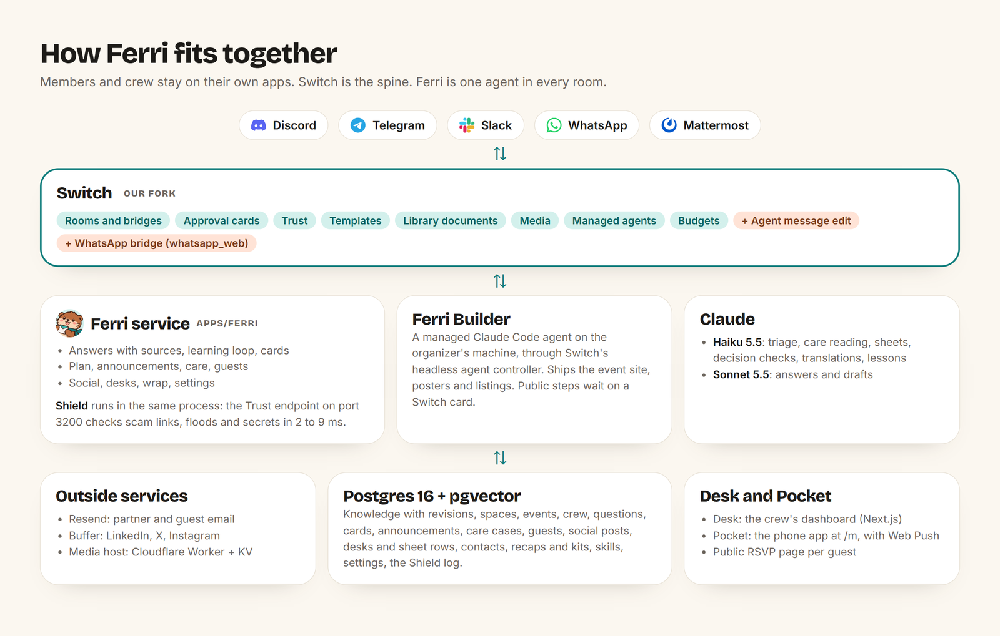

# Architecture

## Why Switch is the spine

Ferri does not work without Switch. Every group on every platform is a Switch room, Ferri is one Switch agent in all of them, every approval is a Switch card, and every message passes Switch Trust. We use Switch as deeply as we could find it:

| Switch feature | What Ferri does with it | Where |
|---|---|---|
| Rooms bridged to Mattermost, Slack, Discord, Telegram and WhatsApp | Every group is a Switch room. One agent connection serves every platform, and one answer fans out to askers on four apps with native mentions. WhatsApp comes through the `whatsapp_web` bridge we added to our fork. | `apps/ferri/src/flow.ts`, `rooms.ts` |
| Always-on custom agent protocol | Our own small TypeScript client: event stream with a string cursor, heartbeat, typing, posting, ops, catch-up after a restart. | `packages/switch` |
| Addressing and `follow_the_conversation` | Ferri tells a real mention from a follow-up, and runs a fast triage model on room chatter it was not addressed in. | `apps/ferri/src/mentions.ts`, `packages/knowledge/src/triage.ts` |
| Question cards (`/agent-sessions/{sid}/approvals`) | Every step that needs a person is a card: unknown questions, replies waiting in Approve spaces, announcement versions, plan decisions, care cases, guest emails, freed spots, social posts, desk packs, outreach emails and closing an event. The ladder (nudge, escalate, close) runs on them. Buttons on Slack, Discord and Telegram; typed answers (`A1 "text"`) everywhere, WhatsApp included. | `apps/ferri/src/loop.ts`, `launch.ts`, `care.ts`, `guests.ts`, `social.ts`, `desks.ts`, `wrap.ts` |
| The card text limit | Switch's text renderer (Mattermost, WhatsApp) shows at most 800 characters of a card's prompt and makes a longer card unanswerable from the message. Ferri posts any prompt over 780 characters as a message just above the card and gives the card a short pointer, so long drafts (a social post for three networks, a guest email) stay answerable. | `packages/switch/src/client.ts` (`openQuestionsCard`) |
| Answering a card as a person (`/gateway/agent-sessions/.../answer`) | Desk and Pocket answer cards through Switch under the signed-in organizer's name. | `apps/desk/lib/cards.ts` |
| Switch Trust (`/guardrails/check`) | Shield, our own Trust endpoint inside the Ferri service: blocks scams and floods, redacts secrets, alerts the crew. | `packages/shield`, `apps/ferri/src/shield.ts` |
| Templates v2 (`create_room_from_yaml`) | "Make team rooms" and "make a judging desk" create real channels on the platform (private or public) with the people asked for, Ferri and a kickoff, attached to the event at once with the desk's mode. | `apps/ferri/src/launch.ts`, `apps/ferri/src/desks.ts`, `packages/knowledge/src/desks.ts` (`deskTemplate`) |
| Library documents | The live knowledge is mirrored into a Switch library document attached to the event's rooms. Each event's living plan, its recap and its starter kit are documents in the crew room, and every desk sheet is a document in its desk room. All of them follow every change. | `packages/knowledge/src/mirror.ts`, `apps/ferri/src/plan.ts`, `wrap.ts`, `desks.ts` |
| Agent media (`/agents/{id}/rooms/{room}/media`) and `read_context` | Posters go out as native images on every platform with one OK. Switch delivers to Ferri only what is addressed to it, so Ferri reads the Builder's files from the room with `read_context`. | `packages/switch/src/client.ts` (`sendMedia`), `apps/ferri/src/builder.ts` |
| Agent management and the headless agent controller | Ferri creates its own Builder through Switch (`create_agent`, after its owner allows it to manage agents): a managed Claude Code agent on a Switch agent controller running on the organizer's machine. Switch starts a Builder session whenever it is addressed and gives it the Switch tools over MCP. | `scripts/builder-setup.ts`, `apps/ferri/src/builder.ts` |
| Handing work to a coding agent (`invite_agent_to_room`, `send_targeted_message`) | Ferri puts the Builder in the crew room and hands each job over as a targeted message, bound to that one room through a session of Ferri's own (`X-Switch-Session-Id`). The Builder reports back to Ferri with a targeted message of its own. For a care case, the hand-off happens in the member's own room, and the Builder helps them there. | `packages/switch/src/client.ts` (`roomOp`), `apps/ferri/src/care.ts` |
| Addressing policy (`PUT /gateway/agents/{id}/addressing-policy`) and follow-ups | The policy decides who may address the Builder and answer its cards. Ferri keeps it at the owner everywhere, anyone in the crew rooms, and a member's room only while the Builder helps that member; the room leaves the policy when the case closes. Switch's follow-ups then carry the member's next replies to the Builder without a mention, and Ferri stays quiet on them. | `apps/ferri/src/builder.ts` (`syncPolicy`), `packages/knowledge/src/care.ts` (`builderPolicy`) |
| Session activity and the coding agent's own cards | The Builder's progress shows as Switch activity cards (steps, tool calls, time). Its Claude Code permission prompts and questions become Switch cards in the room, answered there, in Desk or in Pocket (`/gateway/agent-sessions/approvals`). Public steps (deploy, push, email) always ask. | `builder/.claude/settings.json`, `apps/desk/lib/builder.ts` |
| A coding agent shipping to production behind a Switch card | The Builder creates the event site's Supabase project, sets Vercel's environment and deploys; Claude Code's permission prompt for `vercel deploy --prod` is the Switch card the crew answers. | `builder/kits/event-site`, `builder/.claude/skills/ship-event-site` |
| Budgets (`/gateway/tenants/{tid}/budgets`) | The Builder has its own output-token and turn budget per 24 hours. Switch stops it when it is spent; Ferri holds new jobs until the reset, and Desk shows the spend. | `scripts/builder-setup.ts`, `apps/desk/app/(desk)/builder` |
| Room documents as shared context | The hand-off points the Builder at the knowledge and plan documents attached to the crew room; it reads them with `load_internal_documents`, so the brief stays short. | `packages/knowledge/src/builder.ts` |
| Gateway (auth, rooms, agents, collaborations, addressing policy) | Desk and Pocket sign in with Switch accounts. Desk adds Ferri to rooms, discovers spaces, connects Shield. `./ferri connect` adds platform connections. | `apps/desk`, `scripts/` |
| **Agent message edit (new, in our fork)** | Switch had no way for an agent to edit a message it posted. We added it to Switch core. See below. | [`RudraO2/switch@2711974`](https://github.com/RudraO2/switch/commit/2711974943c2e72540e012cb8171c9e59cfd2511) |
| **WhatsApp bridge, `whatsapp_web` (new, in our fork)** | A Switch messaging platform for WhatsApp groups through a linked device, so WhatsApp groups are rooms like any other. See below. | `core/switch_core/bridges/collaboration/whatsapp_web/adapter.py` in the fork, [`RudraO2/switch@e5c2fc6`](https://github.com/RudraO2/switch/commit/e5c2fc68e140f26677ab4fbcf2de8eb1479be22b) |

## What we added to Switch: agent message edit

The bridge pillar needs "fix the announcement everywhere". Switch had no op and no route for an agent to edit its own message, though every platform adapter already had `update_message` and every bridge keeps a map from room event to platform post. So we added it to Switch core, in our fork:

- `POST /agents/{agent_id}/messages/{event_id}/edit` with `{room_id, content}`, returning `{ok, edited}`.
- `AgentCore.edit_message` checks room membership and budget like a post, refuses any message that is not the agent's own (403), and runs the new text through Switch Trust, so Shield checks edits too.
- `CollaborationCore.handle_outbound_edit` finds the platform post in the bridge's message map and calls the adapter. Telegram writes the agent's name into the body, so its edit keeps "Ferri:" at the top.
- Switch's own room history keeps the message as first sent.

We run it as a thin image over the published Switch dev image (`deploy/local/ferri/` in the fork), so nothing else in the stack changes. That image is published as `ghcr.io/rudrao2/ferri-switch-core`, and `./ferri up` runs it. Without that image Ferri still works: an edit falls back to a new post that starts with "Update:".

## What we added to Switch: a WhatsApp bridge

Community groups often live on WhatsApp, and the Switch release we build on had no WhatsApp bridge. We added a messaging platform, `whatsapp_web`, to our fork, the way Switch's own guide adds one: one adapter folder, one line in `platforms.py`, and a docs page (`docs/messaging-platforms/whatsapp_web.md` in the fork).

- It talks to a WAHA sidecar (the GOWS engine) linked to the organizer's own number, by QR code or pairing code. The adapter dials out to WAHA's event WebSocket and posts through its REST API, so no public address is needed.
- Only the chats named in the connection's `chats` list become rooms (group names or ids, `*` for every group, `me` for the "Message yourself" chat). The organizer's other chats never reach Switch.
- Agents post as "*Ferri:* ...". Posts are paced like a person: typing first, at least 3 seconds between posts in one chat, at most 30 an hour, and refused past the cap rather than queued. The bridge never relays its own posts back.
- Quote replies are threads. Edits, deletes and attachments go both ways. Cards are answered by typing (`A1 1`).
- 26 adapter tests in the fork (config, pacing, which chats, the echo filter, the self chat, media, edit, delete, the cap). The adapter ships in the same thin core image; the sidecar is a compose profile, `whatsapp`, in this repo's `compose.yml`. Setup: [whatsapp.md](whatsapp.md).

## How it fits together

<p align="center"></p>

<details>
<summary>The same picture as text</summary>

```
 Discord   Slack   Telegram   Mattermost   WhatsApp (WAHA sidecar)    members and crew, on their own apps
    \        |        |          /           /
     +-------+--------+---------+-----------+
                  |
          Switch (our fork)       rooms, bridges, cards, templates, library docs, media,
                  |               Trust, budgets, agent message edit, whatsapp_web
        +---------+----------+
        |                    |
  Ferri service         Shield (Trust endpoint, same process, port 3200)
  apps/ferri            packages/shield: scam links, floods, secrets, 2-9 ms
        |
        |  invite_agent_to_room, send_targeted_message      Switch agent controller (headless,
        +-------------------------------------------------> on the organizer's machine): Ferri
           "Job B1 done:" back to Ferri                     Builder, a managed Claude Code agent
                                                            with its own folder, Claude home
                                                            and budget
  flow, learning loop, plan,         Claude Haiku 5.5: triage, care reading, sheets,
  announcements, care, guests, ----> decision check, translations, lessons
  social, desks, wrap, settings      Claude Sonnet 5.5: answers and drafts
        |
        +---->  Resend (outreach and guest email), Buffer (LinkedIn, X, Instagram),
        |       media host (Cloudflare Worker + KV, infra/media-worker)
        |
  Postgres 16 + pgvector (knowledge with revisions, spaces, events, crew, questions,
        |                 cards, announcements, cases, guests, social posts, desks
        |                 and sheet rows, contacts, recaps and kits, skills, settings,
        |                 shield log)
        |
  Desk (Next.js)  +  Ferri Pocket (PWA at /m, Web Push)  +  public /rsvp/<code>
```

</details>

## The Docker stack

`compose.yml` runs the whole thing. `./ferri up` writes `.env` first; after that, `docker compose up -d` alone also works.

| Service | What it is | Host port |
|---|---|---|
| `switch-db`, `switch-db-init` | Switch's Postgres, the `mattermost` database and Switch's runtime role | none |
| `switch` | Switch core (Ferri's core image) | 8800 (`API_HOST_PORT`) |
| `gateway` | Switch's dashboard | 3300 (`GATEWAY_HOST_PORT`) |
| `mattermost`, `mattermost-setup` | Local chat for trying Ferri, and Switch's seeder for it (profile `mattermost`, on by default) | 8065 (`MATTERMOST_HOST_PORT`) |
| `ferri-db` | Ferri's Postgres 16 with pgvector | 5433 (`FERRI_DB_HOST_PORT`) |
| `ferri-setup` | One-shot: registers Ferri in Switch, makes the rooms and test people, loads the demo knowledge (`scripts/stack.ts setup`) | none |
| `ferri` | The agent, with Shield on port 3200 inside the stack | none |
| `desk` | Desk and Ferri Pocket | 3100 (`DESK_HOST_PORT`) |
| `ferri-cli` | One-off commands: `./ferri doctor`, `./ferri connect ...`, `./ferri kb ...` (profile `cli`) | none |
| `waha` | WhatsApp sidecar (profile `whatsapp`) | none |

- Every host port binds to `SWITCH_BIND_ADDR` (127.0.0.1 by default), so nothing is open to the network.
- Images: `ghcr.io/rudrao2/ferri` (built from this repo's `Dockerfile`, one image for Ferri, Desk and the commands) and `ghcr.io/rudrao2/ferri-switch-core` (Switch's published core `0.31.1-dev.339.g86d5928` plus our fork's agent message edit and WhatsApp bridge, from [`RudraO2/switch`, branch `ferri/agent-message-edit`](https://github.com/RudraO2/switch/tree/ferri/agent-message-edit)). Both are multi-arch (amd64 and arm64). Switch's gateway and setup images are Switch's own, pinned to the same release. Mattermost is amd64 only and runs emulated on Apple Silicon.
- If Ferri's image cannot be pulled, `./ferri up` builds it from the checkout.
- `.env` is the one settings file. `./ferri up` copies `.env.example`, asks for the Anthropic key, generates every secret (database passwords, `SECRET_KEYS`, `CONTROLLER_TOKEN_SECRET`, the admin and Mattermost passwords, Desk's session secret, the Web Push keys, the WhatsApp sidecar key), and sets Switch's feature flags (`agent_management,service_connections,follow_the_conversation`). Setup then writes Ferri's agent key and room ids to it. Running `./ferri up` again changes nothing that is already set, and adds any new settings from `.env.example`.

## Repository layout

```
compose.yml          the whole stack: Switch, Mattermost, Ferri's Postgres, setup, Ferri, Desk
Dockerfile           one image for Ferri, Desk and the command-line tasks
ferri, ferri.cmd     the one command (macOS, Linux, Git Bash; Windows PowerShell or cmd)
.env.example         every setting, grouped: required, models, the stack, Ferri, behaviour, optional parts
apps/ferri/          the Ferri agent service: message flow, learning loop, the plan,
                     announcements, scheduler, reminders, team rooms, outreach, care,
                     guests, social, desks, wrap, settings, Shield's HTTP route
apps/desk/           Desk (Next.js), Ferri Pocket (the PWA at /m) and the public RSVP page (/rsvp/<code>)
packages/switch/     our client for the Switch agent protocol and Gateway
packages/knowledge/  seeding, search, prompts, triage, answers with sources, drafts, the Switch mirror,
                     care, guests, social texts, desks and sheets, recap and starter kit, skills, settings,
                     the doctor's checks and platform connections
packages/shield/     Shield's detectors (pure, no network) and its log
packages/push/       Web Push subscriptions and notices
packages/email/      Resend for sending and receiving, webhook signatures, reply addresses
packages/social/     our Buffer GraphQL client and the client for Ferri's media host
packages/db/         Drizzle schema and migrations (Ferri runs them on start)
seed/                the demo community (Lantern Labs) and event (Lantern Build Night)
skills/              Ferri's persona and answer rules, in markdown
  desks/             11 desk skills (help, judging, mentors, volunteers, checkin, speakers,
                     sponsors, food, safety, tables, lost-found)
  packs/             6 desk packs (hackathon, meetup, game-night, festival, workshop, conference)
builder/             Ferri Builder's workspace template: its CLAUDE.md and permission rules
  kits/              The Builder's kits: event-site (Next.js + Supabase), posters (Satori), listings (Playwright)
  .claude/skills/    Its skills: ship-event-site, make-posters, list-event, find-partners, help-member
scripts/             the stack's setup and summary (stack.ts), doctor, connect, smoke test, Switch setup,
                     knowledge CLI, evals, test people, Shield connect, Builder setup and controller,
                     email setup, WhatsApp pairing
infra/               the Cloudflare tunnel example, and the older Postgres-only compose file
  media-worker/      the media host for social images (Cloudflare Worker + Workers KV)
docs/                setup and feature guides
.github/workflows/   CI (typecheck, tests, Desk build, stack smoke test) and image publishing
```
